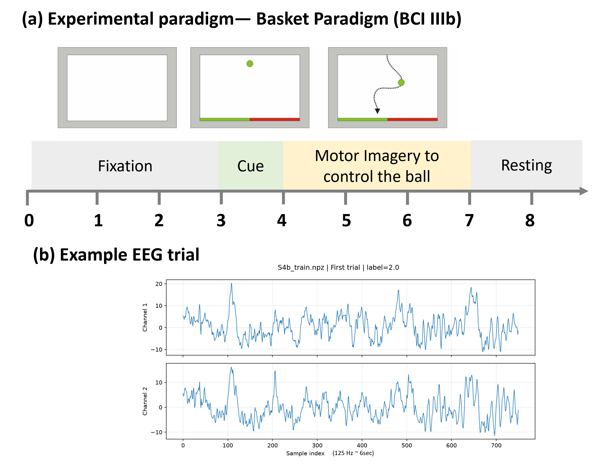
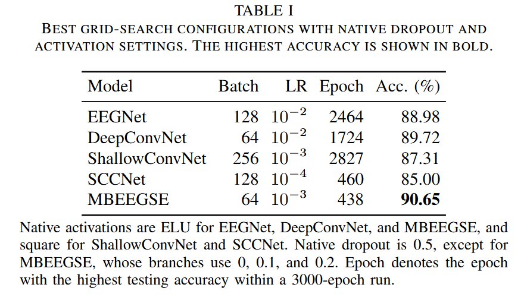
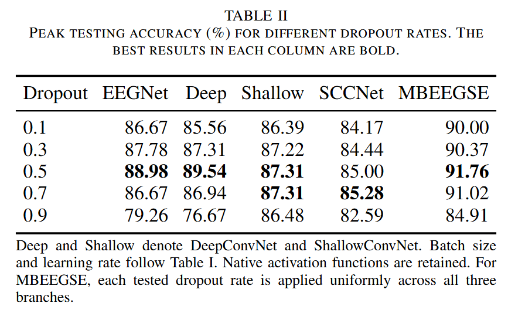
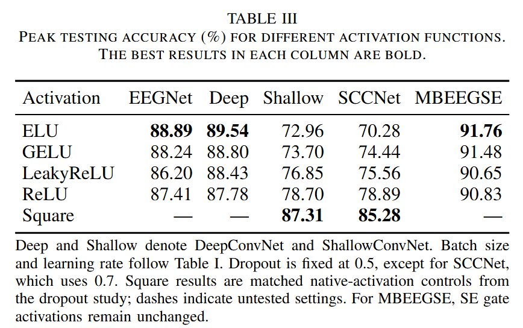

# AIMI2026Fall-LAB2

NYCU CS AIMI Fall 2026 Lab 2: **EEG Classification**.

This project implements **EEGNet** for left- versus right-hand motor imagery classification and compares it with **DeepConvNet, ShallowConvNet, SCCNet, and MBEEGSE**. Experiments include model-specific hyperparameter tuning and dropout/activation ablation studies.

For the full report, see [LAB2_412551030_黃羿寧.pdf](./LAB2_412551030_黃羿寧.pdf).


## Dataset and Experimental Paradigm

The experiments use the provided **BCI Competition III Dataset IIIb** data from subjects **S4b** and **X11b**. Each trial contains two bipolar EEG channels and 750 samples per channel, corresponding to approximately six seconds at 125 Hz. The combined training and testing splits each contain 1080 trials.

The basket paradigm involves visual cues, motor imagery, and online feedback. The schematic timeline and example EEG below are shown on separate axes; the NPZ files do not establish the segment's alignment with cue onset.



Dataset reference: [BCI Competition III](https://www.bbci.de/competition/iii/).

## Model Comparison

The table and figure below summarize each model's best batch-size/learning-rate configuration while retaining its native dropout and activation settings. All runs used **3000 epochs and seed 42** on an **NVIDIA GeForce RTX 5070 Ti**.



Native activation is ELU for EEGNet, DeepConvNet, and MBEEGSE, and square for ShallowConvNet and SCCNet. Native dropout is 0.5, except for MBEEGSE's branch-specific rates of 0, 0.1, and 0.2.

## Ablation Studies

### Dropout Rate

Dropout rates **0.1, 0.3, 0.5, 0.7, and 0.9** were compared using each model's selected batch size and learning rate, with native activation retained. MBEEGSE's dropout ablation applies the same rate to all branches.



EEGNet, DeepConvNet, and MBEEGSE performed best at 0.5; SCCNet preferred 0.7, while ShallowConvNet tied at 0.5 and 0.7. The highest observed score across all experiments was **91.76%**, achieved by MBEEGSE with batch size 64, learning rate 0.001, dropout 0.5, and ELU.

### Activation Function

**ELU, GELU, LeakyReLU, and ReLU** were compared using each model's selected batch size, learning rate, and dropout. Native square controls are also included for SCCNet and ShallowConvNet. MBEEGSE's SE gate activations remain fixed.



ELU achieved the highest activation-study scores for EEGNet (**88.89%**), DeepConvNet (**89.54%**), and MBEEGSE (**91.57%**). SCCNet and ShallowConvNet performed best with native square activation. Replacing square also changes their power-based representation before the log operation.

The MBEEGSE ELU and dropout=0.5 results come from separate training runs. Their 91.57% and 91.76% peaks reflect run-to-run variation under nondeterministic GPU execution despite using the same seed.

**Evaluation protocol:** testing accuracy was used for both checkpoint and hyperparameter selection. Peak scores are therefore subject to test-set selection bias and should not be interpreted as independent final generalization estimates. Results are from a single seed; repeated-seed uncertainty is not reported.

## Implementation

The models are implemented in PyTorch. EEGNet uses temporal filtering, depthwise spatial convolution, and depthwise separable convolution. The other models explore deeper convolutional hierarchies, power-based features, spatial component extraction, and multi-branch attention.

These are reference-based architectures adapted to the two-channel, two-class task, rather than full reproductions of every paper's dataset and training protocol. Architecture details and deliberate adaptations are documented in [MODEL_AUDIT.md](MODEL_AUDIT.md) and citations are provided in [references.bib](references.bib).

Training uses Adam with zero optimizer weight decay, model-specific max-norm constraints, and an explicit convolutional L2 penalty for SCCNet. Missing values are imputed using per-electrode training means. No additional normalization is used in the reported experiments.

### Project Structure

```text
.
├── README.md
├── models.py
├── dataio.py
├── run_experiments.py
├── requirements.txt
├── MODEL_AUDIT.md
├── references.bib
├── tests/
├── fig/
│   ├── fig1.png              # Dataset and paradigm
│   ├── fig2.png              # Model comparison
│   ├── fig3.png              # Dropout comparison
│   └── fig4.png              # Activation comparison
└── data/
    ├── S4b_train.npz
    ├── S4b_test.npz
    ├── X11b_train.npz
    └── X11b_test.npz
```

### Environment Setup

Use Python 3.11 and a CUDA-enabled PyTorch installation. The following is one supported installation combination; the recorded experiments used PyTorch 2.14.1+cu132. See [PyTorch installation instructions](https://pytorch.org/get-started/previous-versions/) for other CUDA builds compatible with your NVIDIA driver.

```powershell
conda create -n aimi-lab2 python=3.11 -y
conda activate aimi-lab2
python -m pip install torch==2.7.1 --index-url https://download.pytorch.org/whl/cu128
python -m pip install -r requirements.txt
python -c "import torch; print(torch.__version__); print(torch.cuda.is_available()); print(torch.cuda.get_device_name(0))"
```

Place the four NPZ files in `data/`, or specify an existing location with `--data-dir PATH_TO_DATA`. 

### Run Experiments

Run commands from the repository root. First check the implementation and planned jobs:

```powershell
python -m unittest discover -s tests -v
python run_experiments.py --dry-run --sweep-models all
```

Full grid search and ablations for all five models:

```powershell
python run_experiments.py --device cuda --profile paper --models all --sweep-models all --epochs 3000 --output-dir outputs_full
```

| Stage | Search settings | Runs |
|---|---|---:|
| Grid | 5 models × 4 batch sizes × 4 learning rates | 80 |
| Dropout | 5 models × 5 rates | 25 |
| Activation | 5 models × 4 functions | 20 |
| **Total** | **3000 epochs per run** | **125** |

Batch sizes are `{32, 64, 128, 256}` and learning rates are `{0.01, 0.001, 0.0001, 0.00001}`. This is a sequential search: grid → dropout → activation. Activation sweeps fix the best dropout from the preceding stage.

Re-run the same command to resume interrupted work. Checkpoints are saved every 50 epochs by default. Existing results are skipped only when source, data, and configuration checks match. For a fresh rerun, use a new output directory such as `--output-dir outputs_rerun`.

To run grid search for every model but restrict ablations to EEGNet, omit `--sweep-models all` (89 runs). 

### Results and Plots

Each run saves configuration, per-epoch history, best/final checkpoints, predictions, confusion matrix, and training/testing accuracy and loss curves. Summary CSVs and comparison plots are generated under the output directory, including `grid_best_by_model.csv`, `best_by_model.csv`, and per-model dropout/activation comparisons.

```powershell
python run_experiments.py --mode plots --output-dir outputs_full
```
